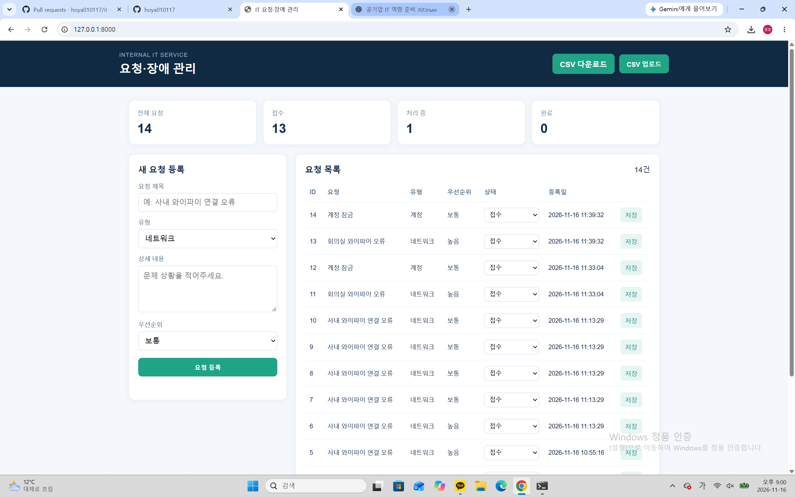

# IT 요청·장애 관리 도구

IT 요청을 등록하고 처리 상태를 관리하며, CSV로 요청 데이터를 가져오고 내보내는 포트폴리오 프로젝트입니다.

## 주요 기능

- IT 요청 등록 및 목록 조회
- 요청 상태 변경: 접수, 처리 중, 완료
- 상태별 요청 건수를 보여주는 대시보드
- CSV 파일로 여러 요청 일괄 등록
- 필수 항목과 우선순위 검증 및 오류 안내
- Excel에서 한글이 깨지지 않도록 CSV 내보내기

## 기술 스택

- Python, FastAPI
- SQLite
- HTML, CSS, JavaScript
- Git, GitHub

## 실행 방법

```bash
git clone https://github.com/hoya010117/it-support-desk.git
cd it-support-desk

python3 -m venv .venv
source .venv/bin/activate
python -m pip install -r requirements.txt

uvicorn app.main:app --reload
```

대시보드: <http://127.0.0.1:8000/>

API 문서: <http://127.0.0.1:8000/docs>

## 사용 방법

1. 대시보드에서 요청을 등록합니다.
2. 요청 목록에서 처리 상태를 변경합니다.
3. CSV 다운로드 버튼으로 요청 내역을 내려받습니다.
4. CSV 업로드 버튼으로 여러 요청을 등록합니다. 결과와 오류 안내가 화면에 표시됩니다.

CSV에는 `title`, `category`, `description` 열이 필요합니다. `priority`는 선택 항목이며 `낮음`, `보통`, `높음` 중 하나를 사용합니다.

## API

| Method | 경로 | 설명 |
|---|---|---|
| GET | `/requests` | 요청 목록 조회 |
| POST | `/requests` | 요청 등록 |
| PATCH | `/requests/{request_id}/status` | 요청 상태 변경 |
| GET | `/requests/export.csv` | 요청 목록 CSV 다운로드 |
| POST | `/requests/import.csv` | CSV 파일 일괄 등록 |

## 대시보드 화면



## 데이터 저장

요청 데이터는 로컬 SQLite 파일 `requests.db`에 저장됩니다. 이 파일은 GitHub 저장소에 올리지 않습니다.
